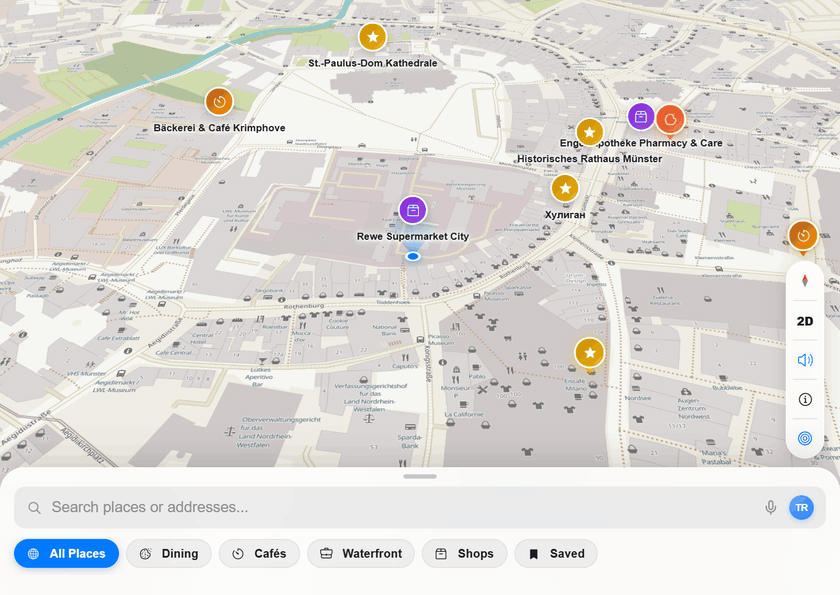

# Maps — 3D Automotive Cockpit & Apple Maps Navigation



A browser-based 3D automotive navigation cockpit and Apple Maps-inspired spatial exploration web app built with **React 19**, **TypeScript**, **Vite**, and **MapLibre GL**.

## Key Features

- **Fluid Apple Maps Bottom Sheet (`peek` / `half` / `full`)**: Direct-manipulation 1:1 touch & pointer physics with rubber-band resistance, momentum projection, live Photon/OSM geocoding search, Web Speech API voice dictation, category filtering chips, and inline custom favorite place creation.
- **Multi-Mode Route Planning & Turn-by-Turn Steps**: Interactive route preview supporting **Fastest**, **Eco** (fuel-saving metric estimation), and **No Highways** routing profiles via OSRM, complete with an expandable Turn-by-Turn Steps drawer and dual-layer SVG + WebGL route ribbons.
- **3D Heading-Up Automotive Cockpit HUD**:
  - **Multi-Step Lookahead Lane Guidance**: Synthesizes and parses lane connectivity (`left`, `through`, `right`, `slight_left`, `slight_right`) and highlights compound lookahead maneuvers (`THEN` sub-banner).
  - **German StVO § 8 *Rechts vor Links* Radar Alert**: Predictive right-of-way monitoring in 30 km/h residential zones with spatial audio warnings.
  - **European Regulatory Speedometer & Autobahn Sign**: Real-time speed tracking with StVO red-ring speed limit signs, German Autobahn advisory signs, and dynamic overspeed alerts.
  - **Interactive Driving Simulator**: Built-in `Simulate` mode that drives the vehicle smoothly along any calculated route with live maneuver distance countdowns and real-time ETA updates.
- **100% On-Device Private Timeline**: Local-only trip history, visited stops, analytics insights, and JSON export/import with zero external tracking.

## Run Locally

Requires Node.js 18+ and npm.

```sh
npm install
npm run dev
```

### Production Build & Linting

```sh
npm run lint   # Runs oxlint (0 warnings, 0 errors)
npm run build  # Type-checks with tsc -b and builds optimized Vite bundle
```

## How the Demo GIF is Embedded on GitHub

The animated preview above is stored directly in the repository at [`assets/demo.gif`](./assets/demo.gif) and embedded in `README.md` using standard Markdown image syntax:

```markdown

```

## Privacy & Location Data

The app can request device hardware GPS location and stores saved favorites and timeline history exclusively in your browser's `localStorage`. Search and routing requests query public OpenStreetMap / OSRM / Photon endpoints.
